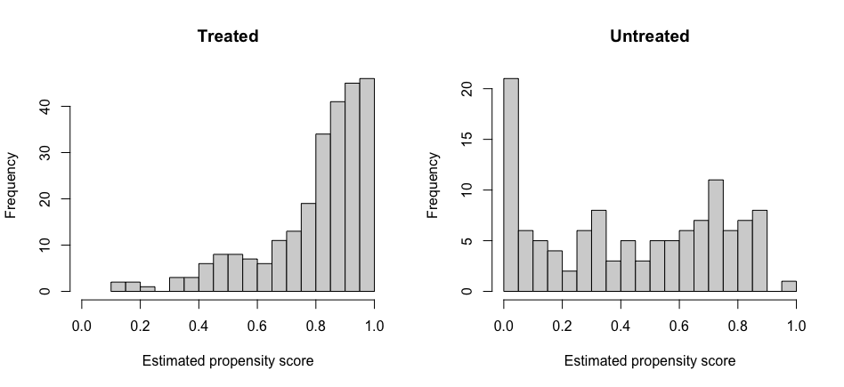

# RMST-Based Causal Inference with Pseudo-values (R)

Simulation code for my Winter UROP project on estimating the average treatment
effect on restricted mean survival time (RMST) under right censoring.
The main results use simulated data; a short real-data illustration with a
public example dataset is described at the end.

## Overview
Hazard ratios are hard to interpret when proportional hazards fails. RMST, the
area under the survival curve up to τ, avoids that assumption. With censoring,
individual RMST is not observed, so I use jackknife **pseudo-values** to turn
RMST into an individual-level outcome and then apply standard causal estimators:

- **RA**: regression adjustment (outcome regression)
- **IPW**: inverse probability weighting
- **DR**: doubly robust (AIPW)

The target is the average treatment effect on RMST:

```math
\Delta_\tau = E[\min\{T(1), \tau\}] - E[\min\{T(0), \tau\}]
```

The estimators follow the pseudo-value approach of Andersen et al. (2017) and
Choi et al. (2022).

## Data-generating process
- Covariates: X₁ ~ N(0, 1), X₂ ~ Bernoulli(0.5)
- Treatment: A ~ Bernoulli(0.5) (randomized)
- Survival time: T(a) ~ Exponential(λ(a)), with λ(a) = exp{−(X₁ + X₂ + a(X₁ + X₂))}
- Censoring: C ~ Exponential(e⁻³), independent of (T, A, X)
- n = 300, τ = 10, B = 100 replications
- The true Δτ is computed in closed form from the exponential RMST,
  (1 − e^(−λτ)) / λ, averaged over the sampled covariates.

## Estimators
Pseudo-values Ỹᵢ come from `pseudo::pseudomean()`, where μ̂ is the
Kaplan-Meier-based RMST estimate and μ̂⁽⁻ⁱ⁾ leaves out observation i:

```math
\tilde Y_i = n\,\hat\mu_\tau - (n-1)\,\hat\mu_\tau^{(-i)}
```

With outcome models m̂ₐ(X) and propensity score ê(X):

```math
\hat\Delta^{\mathrm{RA}} = \frac{1}{n}\sum_{i=1}^n \left\{\hat m_1(X_i) - \hat m_0(X_i)\right\}
```

```math
\hat\Delta^{\mathrm{IPW}} = \frac{1}{n}\sum_{i=1}^n \left\{\frac{A_i \tilde Y_i}{\hat e(X_i)} - \frac{(1-A_i)\tilde Y_i}{1-\hat e(X_i)}\right\}
```

```math
\hat\Delta^{\mathrm{DR}} = \frac{1}{n}\sum_{i=1}^n \left\{\hat m_1(X_i) - \hat m_0(X_i) + \frac{A_i\{\tilde Y_i - \hat m_1(X_i)\}}{\hat e(X_i)} - \frac{(1-A_i)\{\tilde Y_i - \hat m_0(X_i)\}}{1-\hat e(X_i)}\right\}
```

The outcome model is a linear regression of the pseudo-values on A × (X₁ + X₂)
interaction terms, and the propensity score is a logistic regression on (X₁, X₂).

## Results (B = 100, n = 300, τ = 10; average true effect = 1.4515)

| Estimator | Mean | SD | Bias | MC SE of bias |
|---|---|---|---|---|
| RA  | 1.4701 | 0.2901 | 0.0186 | 0.0275 |
| IPW | 1.4697 | 0.2877 | 0.0182 | 0.0273 |
| DR  | 1.4700 | 0.2892 | 0.0185 | 0.0274 |

All three estimators are close to the true effect and have similar variability.
The bias of about 0.018 is smaller than its Monte Carlo standard error (about
0.027), so with B = 100 it cannot be distinguished from zero. This does not by
itself show that the estimators are unbiased.

The true effect is computed analytically within each replication from that
replication's sampled covariates. The reported value is the mean of these
replication-specific effects, not a separately computed population ATE.

## Notes and limitations
- **Independent censoring:** Censoring is generated independently of treatment,
  covariates, and event times, which is the setting the Kaplan-Meier-based
  pseudo-values require.
- **Randomized treatment:** Treatment is assigned independently of the
  covariates, so this simulation does not evaluate the estimators under
  confounding.
- **Outcome model:** The linear model includes treatment-covariate interactions
  but is not the exact (nonlinear) conditional RMST.
- **Double robustness:** The DR estimator combines outcome regression and
  propensity weighting, but this simulation does not test its double
  robustness. That would require comparing correctly specified and misspecified
  nuisance models.

A natural extension is confounded treatment assignment with deliberately
misspecified nuisance models. The script has an `assignment = "confounded"`
option as a starting point.

## Real-data illustration (GSE6532)
To see how the same estimators behave outside a simulation, I applied them to
the example data of the `drRML` package (see **Data** below): 374 patients, 255
treated with tamoxifen and 119 untreated, with distant-metastasis-free time as
the outcome (25.4% events). The covariates are age, tumor size, grade, and ER
status, and τ is 5 years (1825 days). This is an illustration of the method, not
a clinical analysis.

**Data.** The `gse` dataset included in the R package
[`drRML`](https://github.com/taehwa015/drRML) (Choi et al., 2022; GPL-3). It is
the GSE6532 cohort of tamoxifen-treated and untreated breast cancer patients
(Loi et al., 2007), originally from NCBI GEO (accession GSE6532). It is loaded
with `data(gse)` from the installed package and is not copied into this
repository.

Difference in 5-year RMST (treated − untreated), in days. Standard errors come
from 200 bootstrap replications, and 95% confidence intervals use the normal
approximation (estimate ± 1.96 × bootstrap SE):

| Estimator | Estimate | Bootstrap SE | 95% CI |
|---|---|---|---|
| RA  | −0.54  | 77.29 | (−152.02, 150.95) |
| IPW | 226.39 | 91.91 | (46.24, 406.54) |
| DR  | 91.63  | 97.72 | (−99.90, 283.15) |

The DR point estimate agrees with `drRML::dr_rml()` (91.63 days) under the same
specification, which serves as a consistency check on the implementation.

### Why the estimators disagree
`03_real_data_diagnostics.R` checks overlap, balance and sensitivity:



- **Strong imbalance.** Treated patients are older (mean age 63.8 vs 52.1) and
  almost all ER-positive (98% vs 71%); only 5 treated patients are
  ER-negative. Standardized mean differences before weighting: Age 1.21,
  ER 0.80, Size 0.54, Grade −0.01.
- **Limited overlap.** 68 of 374 patients have an estimated propensity score
  outside [0.05, 0.95].
- **Moderate weights, reduced precision.** The largest IPW weight is 21.8, but
  the effective sample size falls to 182 of 255 (treated) and 63 of 119
  (untreated). IPW reduces imbalance (Age 1.21 → 0.34, ER 0.80 → 0.21,
  Size 0.54 → 0.09) but does not remove it.
- **Sensitivity** (point estimates, days):

| Specification | RA | IPW | DR |
|---|---|---|---|
| Baseline | −0.5 | 226.4 | 91.6 |
| PS clipped to [0.05, 0.95] | −0.5 | 229.4 | 86.6 |
| PS trimmed to [0.05, 0.95] (n = 306) | 2.4 | 145.0 | 28.8 |
| Quadratic Age and Size | 44.4 | 232.8 | 126.3 |
| Grade as factor (outcome model) | 13.7 | 226.4 | 98.0 |

IPW is consistently the largest estimate and changes little when the propensity
scores are clipped, so it is not highly sensitive to extreme scores at this
threshold. Limited overlap and residual imbalance may still contribute to the
differences among estimators. Trimming to patients with moderate propensity
scores lowers IPW to 145 and DR to 29 days, but trimming changes the target
population, so these estimates are not directly comparable to the full-sample
ones.

The median pseudo-value is 1834 days, slightly above τ. Pseudo-values are
jackknife-derived quantities rather than observed survival times, so they are
not bounded by τ, and the adequacy of the linear outcome model remains
uncertain. The Kaplan-Meier-based pseudo-values also rely on assumptions about
the censoring mechanism, which were not verified in this observational dataset.

Overall, these data do not give a stable estimate: results depend on the
estimator and the specification, and the DR interval includes zero. Unmeasured
confounding cannot be ruled out, so the estimates should be read as exploratory
rather than definitive causal effects. A few rank-deficiency warnings appeared
in bootstrap samples, consistent with only 5 ER-negative treated patients.

## Files
- `01_simulation.R`: full simulation and summary table
- `02_real_data.R`: application to the GSE6532 data from the drRML package
- `03_real_data_diagnostics.R`: overlap, balance and sensitivity checks for the real-data example

## Reproduce
```r
install.packages(c("survival", "pseudo", "remotes"))
remotes::install_github("taehwa015/drRML")   # only needed for the real-data scripts
source("01_simulation.R")                    # seed is set inside the script
source("02_real_data.R")
source("03_real_data_diagnostics.R")
```

## References and background reading
- Andersen PK, Perme MP (2010). Pseudo-observations in survival analysis. *Statistical Methods in Medical Research*, 19, 71–99.
- Andersen PK, Syriopoulou E, Parner ET (2017). Causal inference in survival analysis using pseudo-observations. *Statistics in Medicine*, 36, 2669–2682.
- Choi S, Choi T, Lee HY, Han SW, Bandyopadhyay D (2022). Doubly-robust methods for differences in restricted mean lifetimes using pseudo-observations. *Statistics in Medicine*, 41, 2223–2241.
- Funk MJ, Westreich D, Wiesen C, Stürmer T, Brookhart MA, Davidian M (2011). Doubly robust estimation of causal effects. *American Journal of Epidemiology*, 173, 761–767.
- Efron B (1982). *The Jackknife, the Bootstrap and Other Resampling Plans*. SIAM.
- Imbens GW, Rubin DB (2015). *Causal Inference for Statistics, Social, and Biomedical Sciences*. Cambridge University Press.
- Loi S, Haibe-Kains B, Desmedt C, et al. (2007). Definition of clinically distinct molecular subtypes in estrogen receptor-positive breast carcinomas through genomic grade. *Journal of Clinical Oncology*, 25(10), 1239–1246.

## Acknowledgment
Developed during the Winter UROP at Sungshin Women's University under the
supervision of Prof. Taehwa Choi.
